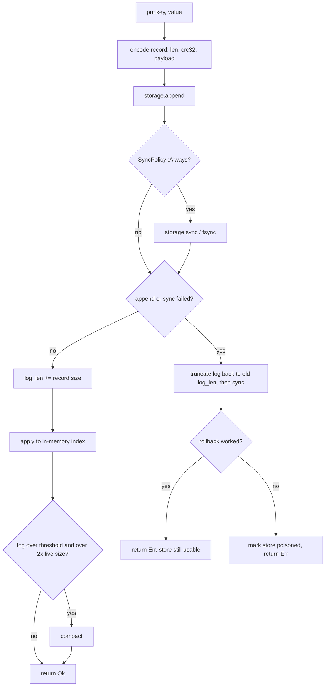
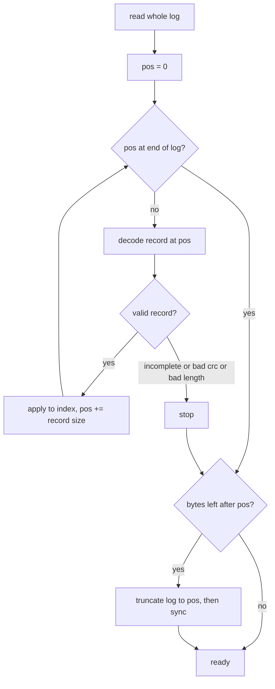

# Write path and recovery path

## Write path (`put` and `delete`)

The index is updated only after the record is confirmed. The rollback on failure is the fix described in [writeup.md](writeup.md). Without it, a partial record could stay in the log and hide every later write from recovery.

## Recovery path (`Store::open`)

Truncating before accepting new writes matters. If the damaged tail stayed in the file, the next acknowledged write would land behind it and be dropped on the following restart.

## Compaction

`compact` encodes one put per live key into a buffer and calls `storage.replace`. The file implementation writes a temp file, fsyncs it, renames it over the log and fsyncs the directory. A crash leaves either the old log or the new one. A stale temp file from a crash before the rename is deleted on the next open.
